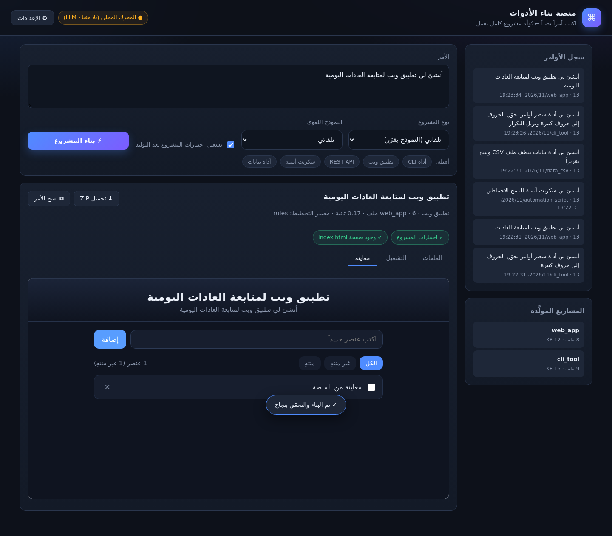

# منصة بناء الأدوات — AiBuilder Studio

> **منصة ويب تكتب لها أمراً نصياً، فتُنتج لك أداة أو برنامجاً كاملاً يعمل** — كود + اختبارات + توثيق، مع معاينة حيّة وتحميل ZIP.

[](https://github.com/mqdadalhryby-star/habit-tracker/actions/workflows/ci.yml)


**🔗 النسخة الحية (موقع مولَّد بالمنصة):** <https://mqdadalhryby-star.github.io/habit-tracker/>

<p align="center">
  
</p>

## 🚀 شغّل المنصة بأمر واحد
```bash
git clone https://github.com/mqdadalhryby-star/habit-tracker.git
cd habit-tracker/ai-builder
python3 studio/server.py
# → افتح http://localhost:8000
```
بلا أي تثبيت: **بايثون القياسي فقط** (3.10+).

## ☁️ انشرها على الإنترنت (رابط عام — نقرتان)
زر أسفل يفعّل نشر Render مباشرة من مستودعك (الملف `ai-builder/studio/render.yaml` جاهز):

<p align="center">
  <a href="https://render.com/deploy?repo=https://github.com/mqdadalhryby-star/habit-tracker">
    
  </a>
</p>

<details>
<summary>أو عبر Docker</summary>

```bash
cd ai-builder
docker build -f studio/Dockerfile -t ai-builder-studio .
docker run -p 8000:8000 -v "$PWD/studio/generated:/app/generated" ai-builder-studio
```
</details>

## 🧭 كيف تعمل المنصة
```
الأمر النصي
   │  POST /api/build
   ▼
ai_builder ── تخطيط (محرك قواعدي عربي/إنجليزي + LLM اختياري)
            ── توليد ملفات المشروع
            ── تشغيل اختبارات المشروع المولَّد فعلياً  ← لا تُسلَّم مشاريع غير مُتحقَّق منها
   ▼
الواجهة: خطة التنفيذ · شارات التحقق · شجرة الملفات · عارض الكود · معاينة حيّة · تحميل ZIP
```

## ✨ ما تحتويه المنصة
| الميزة | الوصف |
|---|---|
| وحدة أوامر | اكتب الأمر، اختر النوع والنموذج، اضغط ⚡ بناء |
| خطة تنفيذ | نوع المشروع · الأسماء · العمليات المستخرجة · مصدر التخطيط · الزمن |
| تحقق فعلي | يشغّل اختبارات المشروع المولَّد ويعرض النتيجة كشارات ✅/❌ |
| عارض ملفات | شجرة ملفات + عرض الكود + نسخ |
| معاينة حيّة | `iframe` يشغّل تطبيق الويب المولَّد داخل المنصة |
| تحميل | المشروع كاملاً كـ ZIP |
| سجل ومشاريع | استدعاء أي أمر سابق، وفتح أي مشروع مولَّد |
| إعدادات LLM | تلصق مفتاح MiniMax من الواجهة → يُحفظ محلياً بصلاحية 600 |

## 🧰 أنواع المشاريع التي تولّدها المنصة
| النوع | الناتج |
|---|---|
| `cli_tool` | أداة سطر أوامر بمعالجة نصوص حقيقية (uppercase / sort / unique / json_format …) |
| `web_app` | تطبيق ويب صفحة واحدة عربي RTL بلا تبعيات، بتخزين محلي |
| `api_service` | خدمة FastAPI: منطق نقي + نقاط CRUD + توثيق `/docs` |
| `script` | سكربت أتمتة: فحص مجلد + نسخ احتياطي بوضع تجريبي آمن |
| `data_tool` | خط أنابيب بيانات: CSV ← تنظيف ← `cleaned.csv` + `summary.json` + `report.md` |

## 🔌 نقاط API
| الطريقة | المسار | الوظيفة |
|---|---|---|
| POST | `/api/build` | `{request, kind?, provider?, verify?}` → يولّد مشروعاً |
| GET | `/api/status` | حالة الخادم والنموذج اللغوي والأنواع |
| GET | `/api/projects` | المشاريع المولَّدة + سجل الأوامر |
| GET | `/api/files?name=&path=` | شجرة الملفات أو محتوى ملف |
| GET | `/api/download?name=` | تنزيل ZIP |
| GET | `/preview/<project>/<path>` | معاينة ملفات المشروع المولَّد |
| POST | `/api/config` | حفظ مفتاح النموذج اللغوي |

```bash
curl -X POST http://localhost:8000/api/build \
  -H 'Content-Type: application/json' \
  -d '{"request":"أنشئ لي أداة تنظف ملفات CSV وتنتج تقريراً","verify":true}'
```

## 🧪 الاختبارات
```bash
cd ai-builder
python3 -m unittest discover -s tests -t . -v     # 32 اختباراً
```
تشمل اختبارات end-to-end تبني كل نوع مشروع في مجلد مؤقت ثم **تشغّل اختباراته فعلياً**، واختبارات المنصة تشغّل الخادم على منفذ عشوائي وتختبر الواجهة والبناء والمعاينة والتنزيل وحجب `path traversal`.
تُشغَّل تلقائياً عند كل دفع إلى `main` عبر `.github/workflows/ci.yml`.

## 📂 بنية المستودع
```
habit-tracker/
├── docs/                         # لقطات المنصة والموقع
├── .github/workflows/ci.yml      # CI — 32 اختباراً عند كل دفع
└── ai-builder/
    ├── ai_builder/               # النواة: intent · llm · model · spec · cli
    │   └── generators/           # مولّد لكل نوع مشروع
    ├── studio/                   # 🖥 المنصة (خادم + واجهة + Dockerfile + render.yaml)
    ├── tests/                    # 32 اختباراً
    └── README.md
```

## 🔐 الأمان
- لا تُشغَّل أوامر مستخدم كـ shell — التوليد عبر قوالب مُتحقَّق منها.
- `path traversal` محجوب في مسارات الملفات والمعاينة والتنزيل.
- مفتاح LLM يُحفظ في `~/.config/ai-builder/config.json` بصلاحية `600` ولا يُطبع في المخرجات.

## 📄 الترخيص
MIT.
